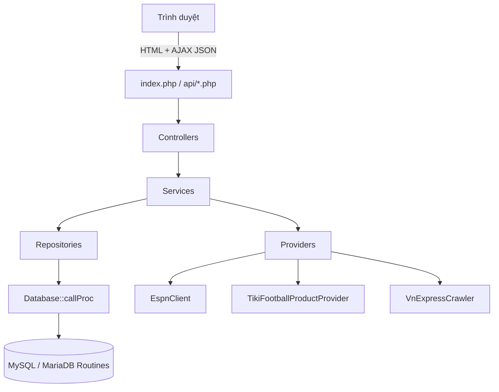

<div align="center">

# FastFootBalInfo

### Nền tảng web tổng hợp thông tin bóng đá — nhanh, trực quan, tập trung

**FastFootBalInfo** — lịch thi đấu, tỉ số trực tiếp, kết quả, giải đấu, đội bóng, bảng xếp hạng, tin tức, sản phẩm bóng đá và khu vực quản trị trong một giao diện thống nhất.

[Giới thiệu](#about) · [Tính năng](#features) · [Công nghệ](#tech-stack) · [Cài đặt](#getting-started) · [Sử dụng](#usage) · [API](#api) · [Đóng góp](#contributing)

</div>

---

<a id="about"></a>

## Giới thiệu

**FastFootBalInfo** là ứng dụng web giúp người hâm mộ theo dõi bóng đá mỗi ngày mà không cần mở nhiều nguồn dữ liệu khác nhau. Ứng dụng tổng hợp lịch thi đấu, tỉ số trực tiếp, thông tin giải đấu, đội bóng, bảng xếp hạng, tin tức và sản phẩm bóng đá từ các nguồn công khai.

Dự án được xây dựng theo kiến trúc **MVC phân tầng**, sử dụng **PHP 8 + MySQL/MariaDB**, giao diện **Bootstrap 5** và giao tiếp **AJAX/JSON**. Điểm khác biệt cốt lõi của dự án là toàn bộ nghiệp vụ SQL được đưa vào **routine của CSDL**; tầng PHP chỉ gọi `CALL routine(?, ...)` thông qua `Database::callProc()`, giúp mã nguồn dễ kiểm soát, bảo trì và hạn chế SQL rải rác trong ứng dụng.

> Dự án được thực hiện trong khuôn khổ học phần **Phát triển ứng dụng Web (UEH)** và được tổ chức theo cấu trúc phù hợp để phát triển tiếp thành sản phẩm thực tế.

### Giá trị mang lại

| Đối tượng | Giá trị |
|---|---|
| Người hâm mộ | Theo dõi trận đấu, lịch thi đấu, kết quả, tin tức và đội yêu thích ở một nơi duy nhất |
| Nhà phân tích / người xem | Tra cứu nhanh bảng xếp hạng, thống kê, đội hình và lịch sử đối đầu |
| Người mua sắm | Khám phá sản phẩm bóng đá kèm giá, hình ảnh và liên kết mua hàng bên ngoài |
| Quản trị viên | Quản lý tài khoản, giải đấu, tin tức và đồng bộ dữ liệu từ một dashboard |
| Lập trình viên | Tham khảo mô hình MVC, repository/service, routine CSDL và AJAX trong PHP thuần |

---

<a id="features"></a>

## Tính năng nổi bật

### Dành cho người dùng

| Tính năng | Mô tả |
|---|---|
| **Tỉ số trực tiếp** | Hiển thị trận đang đá, sắp diễn ra và đã kết thúc; tự cập nhật bằng AJAX theo chu kỳ 30 giây |
| **Lịch thi đấu** | Lọc theo ngày, giải đấu và trạng thái; hỗ trợ phân trang và xem chi tiết từng trận |
| **Chi tiết trận đấu** | Diễn biến chính, đội hình, thống kê, thông tin đối đầu và trạng thái live từ ESPN |
| **Giải đấu & đội bóng** | Danh sách giải, tìm kiếm đội, trang chi tiết đội với trận sắp tới và gần đây |
| **Bảng xếp hạng** | Bảng xếp hạng theo giải đấu, cập nhật từ dữ liệu đồng bộ |
| **Tin tức bóng đá** | Tổng hợp tin từ VnExpress, có tiêu đề, tóm tắt, hình ảnh, liên kết và dẫn nguồn |
| **Sản phẩm bóng đá** | Danh mục sản phẩm từ Tiki với giá, ảnh, thương hiệu, mức giảm giá và link mua ngoài |
| **Đội yêu thích** | Lưu đội bóng yêu thích theo tài khoản, xem lại trong trang cá nhân |
| **Lịch & nhắc trận** | Thêm trận sắp diễn ra vào lịch cá nhân, bật nhắc giờ bóng lăn và nhận thông báo trong web |
| **Tài khoản** | Đăng ký, đăng nhập, đăng xuất; khóa tài khoản tạm thời sau 5 lần đăng nhập sai |
| **Tìm kiếm & phân trang** | Tìm kiếm giải đấu, đội bóng, tin tức và sản phẩm với kết quả được phân trang |

### Dành cho quản trị viên

| Tính năng | Mô tả |
|---|---|
| **Dashboard** | Thống kê dữ liệu đồng bộ và nhật ký hoạt động gần nhất |
| **Quản lý tài khoản** | Tìm kiếm, khóa/mở khóa tài khoản người dùng |
| **Cấu hình giải đấu** | Bật/tắt theo dõi, gán quốc gia và khu vực cho từng giải |
| **Quản lý tin tức** | Thêm, sửa, xóa tin do ADMIN soạn; tải ảnh từ máy lên |
| **Đồng bộ dữ liệu** | Làm mới dữ liệu LIVE, FIXTURES, CATALOG, NEWS hoặc sản phẩm bóng đá theo nhu cầu |

---

<a id="tech-stack"></a>

## Công nghệ sử dụng

### Tổng quan

| Nhóm | Công nghệ / Thư viện | Vai trò |
|---|---|---|
| **Ngôn ngữ** | PHP 8.0+, JavaScript, SQL, HTML5, CSS3 | Xử lý backend, tương tác client và truy vấn dữ liệu |
| **Kiến trúc** | MVC phân tầng, OOP, namespace, autoloader tùy chỉnh | Tách biệt Controller → Service → Repository → Routine |
| **Cơ sở dữ liệu** | MySQL 8.0.16+ / MariaDB 10.2.1+, InnoDB, `utf8mb4` | Lưu trữ dữ liệu và xử lý nghiệp vụ bằng stored procedure |
| **Giao diện** | Bootstrap 5.3.3, Bootstrap Icons 1.11.3, Google Fonts Inter | Layout responsive, component và icon |
| **Tương tác** | jQuery 3.7.1, AJAX, JSON | Cập nhật tỉ số, giá sản phẩm, yêu thích, lịch và thông báo không tải lại trang |
| **Dữ liệu ngoài** | ESPN public API, Tiki JSON API, VnExpress | Nguồn dữ liệu trận đấu, sản phẩm và tin tức |
| **Môi trường** | XAMPP, Apache 2.4 / PHP built-in server, Git | Cài đặt, chạy và quản lý mã nguồn |
| **Kiểm thử** | Script CLI tự viết trong `tools/` | Smoke test, kiểm tra SQL, crawl tin và đồng bộ thật |

### Thư viện & tài nguyên frontend

```text
Bootstrap 5.3.3      https://cdn.jsdelivr.net/npm/bootstrap@5.3.3
Bootstrap Icons      https://cdn.jsdelivr.net/npm/bootstrap-icons@1.11.3
jQuery 3.7.1         https://code.jquery.com/jquery-3.7.1.min.js
Google Fonts Inter   https://fonts.googleapis.com
```

> Dự án **không dùng Composer hoặc npm**. Autoloader được đăng ký thủ công trong `app/bootstrap.php`; tài nguyên frontend tải qua CDN nên cần kết nối Internet khi phát triển.

### Yêu cầu PHP

| Extension | Mục đích |
|---|---|
| `mysqli` | Kết nối MySQL/MariaDB |
| `curl` | Gọi ESPN, Tiki và các nguồn dữ liệu ngoài |
| `mbstring` | Xử lý chuỗi UTF-8 |
| `dom` | Parse HTML khi crawl tin tức |
| `fileinfo` | Kiểm tra định dạng tệp ảnh tải lên |
| `openssl` | Hỗ trợ kết nối HTTPS |

---

<a id="architecture"></a>

## Kiến trúc & luồng dữ liệu



**Nguyên tắc bất biến**

- Nghiệp vụ SQL nằm trong routine CSDL, không rải trong PHP.
- PHP chỉ gọi `CALL tên_routine(?, ...)` qua `Database::callProc()`.
- Tên routine được tập trung tại `app/Core/RoutineName.php`.
- Dữ liệu ngoài chỉ được gọi từ máy chủ; không đưa API key/token xuống trình duyệt.
- `SyncService` quản lý TTL và nhật ký đồng bộ để tránh gọi nguồn quá dày.

**Các provider chính**

| Provider | Nguồn | Dữ liệu |
|---|---|---|
| `EspnClient` | ESPN public API | Trận đấu, lịch, tỉ số, sự kiện, đội hình, thống kê, đối đầu |
| `TikiFootballProductProvider` | Tiki JSON API | Sản phẩm bóng đá, giá, ảnh, thương hiệu, shop |
| `VnExpressCrawler` | VnExpress | Tin tức bóng đá, tiêu đề, tóm tắt, ảnh, liên kết nguồn |

---

<a id="demo"></a>

## Demo & Screenshots

### Demo trực tuyến

> **Live Demo:** _Đang cập nhật_ — thay dòng này bằng URL triển khai của bạn, ví dụ: `https://your-domain.com/`.

### Thêm ảnh chụp màn hình

1. Tạo thư mục `docs/screenshots/` ở thư mục gốc dự án.
2. Đặt ảnh theo gợi ý sau:

```text
docs/screenshots/
├── 01-home.png            # Trang chủ / bảng tỉ số
├── 02-schedule.png        # Lịch thi đấu
├── 03-match-detail.png    # Chi tiết trận
├── 04-standings.png       # Bảng xếp hạng
├── 05-news.png            # Tin tức
├── 06-products.png        # Sản phẩm bóng đá
├── 07-calendar.png        # Lịch cá nhân
└── 08-admin-dashboard.png # Quản trị
```

3. Chèn ảnh vào README bằng Markdown:

```markdown

```

4. Hoặc trình bày dạng lưới:

```markdown
| Trang chủ | Chi tiết trận |
|---|---|
|  |  |

| Bảng xếp hạng | Quản trị |
|---|---|
|  |  |
```

> `.gitignore` hiện đang bỏ qua thư mục `/docs/`. Nếu muốn commit ảnh, hãy xóa dòng `/docs/` khỏi `.gitignore` hoặc dùng `git add -f docs/screenshots/*.png`.

---

<a id="getting-started"></a>

## Bắt đầu

### 1. Yêu cầu hệ thống (Prerequisites)

| Thành phần | Phiên bản / Ghi chú |
|---|---|
| PHP | 8.0 trở lên, bật các extension ở mục [Yêu cầu PHP](#tech-stack) |
| MySQL / MariaDB | MySQL 8.0.16+ hoặc MariaDB 10.2.1+ |
| Web server | Apache 2.4 có `.htaccess`, hoặc PHP built-in server |
| Git | Dùng để clone mã nguồn |
| Internet | Cần cho CDN Bootstrap/jQuery và các API dữ liệu ngoài |

### 2. Clone dự án

```bash
git clone https://github.com/Ddawng18/WEB-InfoFootball.git
cd WEB-InfoFootball
```

### 3. Cấu hình môi trường

Sao chép tệp cấu hình mẫu và điền thông tin thực tế:

```bash
copy config.example.ini config.ini
```

> `config.ini` chứa thông tin CSDL và **không được commit** lên GitHub. Tệp này đã có trong `.gitignore`.

### 4. Import cơ sở dữ liệu

Chạy lần lượt theo đúng thứ tự:

```bash
mysql -u root --default-character-set=utf8mb4 < database/schema.sql
mysql -u root --default-character-set=utf8mb4 < database/seed.sql
mysql -u root --default-character-set=utf8mb4 < database/routines.sql
```

Hoặc dùng đường dẫn XAMPP trên Windows:

```bat
C:\xampp\mysql\bin\mysql.exe -u root --default-character-set=utf8mb4 -e "source database/schema.sql"
C:\xampp\mysql\bin\mysql.exe -u root --default-character-set=utf8mb4 -e "source database/seed.sql"
C:\xampp\mysql\bin\mysql.exe -u root --default-character-set=utf8mb4 -e "source database/routines.sql"
```

> `database/schema.sql` có lệnh `DROP DATABASE IF EXISTS fastfootbalinfo` và `CREATE DATABASE fastfootbalinfo`. Hãy sao lưu dữ liệu cũ trước khi chạy nếu bạn đang nâng cấp.
>
> Trên hosting không cho phép `CREATE DATABASE` / `USE`, hãy bỏ hai nhóm lệnh này trong `schema.sql` và import vào database đã tạo sẵn.

### 5. Nâng cấp CSDL cũ

Nếu đang nâng cấp từ phiên bản trước, chạy các migration theo thứ tự:

```text
database/migrations/001_news_crawl.sql
database/migrations/006_football_products.sql
database/migrations/007_product_shop.sql
database/migrations/008_live_coverage.sql
database/migrations/009_calendar_reminders.sql
```

Sau đó chạy lại:

```bash
mysql -u root --default-character-set=utf8mb4 fastfootbalinfo < database/routines.sql
```

---

<a id="configuration"></a>

## Biến môi trường & cấu hình

Dự án không dùng tệp `.env`; toàn bộ cấu hình được đọc từ `config.ini` theo các section `[app]`, `[db]`, `[api]`, `[sync]` và `[san_pham]`.

### Ví dụ `config.ini`

```ini
[app]
base_url = ""
display_timezone = "Asia/Ho_Chi_Minh"
; debug = 0

[db]
host = "127.0.0.1"
port = 3306
name = "fastfootbalinfo"
user = "root"
pass = ""

[api]
provider = "espn"
espn_base_url = "https://site.api.espn.com/apis/site/v2/sports/soccer"
espn_guide_url = "https://site.web.api.espn.com/apis/personalized/site/v2/guide/feed?limit=200"
espn_leagues = "eng.1,esp.1,ita.1,ger.1,fra.1,uefa.champions,uefa.wchampions,esp.copa_del_rey,mex.w.1,fifa.friendly.w"
espn_request_delay_ms = 150

[sync]
ttl_live = 25
ttl_fixtures = 2700
ttl_catalog = 10800
ttl_news = 30

[san_pham]
sources_file = "config/tiki_source.json"
ttl = 1800
max_san_pham = 450
max_seconds = 100
max_trang = 10
chi_tiet_toi_da = 30
retention_days = 7
timeout = 10
tiki_api_url = "https://api.tiki.vn/v2/products/{id}?platform=web&spid={spid}"
link_hosts = ""
```

### Bảng cấu hình chi tiết

| Section | Khóa | Mặc định | Mô tả |
|---|---|---|---|
| `app` | `base_url` | `""` | URL gốc; để trống để tự nhận diện |
| `app` | `display_timezone` | `Asia/Ho_Chi_Minh` | Múi giờ hiển thị |
| `app` | `debug` | `0` | `0` trên production để không lộ stack trace |
| `db` | `host`, `port` | `127.0.0.1`, `3306` | Địa chỉ MySQL/MariaDB |
| `db` | `name` | `fastfootbalinfo` | Tên database |
| `db` | `user`, `pass` | `root`, `""` | Tài khoản CSDL |
| `api` | `provider` | `espn` | Provider dữ liệu bóng đá |
| `api` | `espn_base_url` | URL ESPN | Endpoint scoreboard |
| `api` | `espn_guide_url` | URL ESPN | Endpoint tổng hợp trận hôm nay |
| `api` | `espn_leagues` | Danh sách slug | Các giải được theo dõi |
| `api` | `espn_request_delay_ms` | `150` | Nghỉ giữa các request để tránh rate-limit |
| `sync` | `ttl_live` | `25` | TTL đồng bộ tỉ số trực tiếp (giây) |
| `sync` | `ttl_fixtures` | `2700` | TTL đồng bộ lịch thi đấu (giây) |
| `sync` | `ttl_catalog` | `10800` | TTL đồng bộ giải/đội (giây) |
| `sync` | `ttl_news` | `30` | TTL đồng bộ tin tức (giây) |
| `san_pham` | `sources_file` | `config/tiki_source.json` | Cấu hình nguồn/danh mục Tiki |
| `san_pham` | `ttl` | `1800` | Khoảng cách kiểm tra giá (giây) |
| `san_pham` | `max_san_pham` | `450` | Số sản phẩm tối đa giữ lại |
| `san_pham` | `max_seconds` | `100` | Thời gian tối đa một lần thu thập |
| `san_pham` | `max_trang` | `10` | Số trang tối đa mỗi từ khóa/danh mục |
| `san_pham` | `chi_tiet_toi_da` | `30` | Số trang chi tiết tối đa mở thêm |
| `san_pham` | `retention_days` | `7` | Số ngày giữ sản phẩm cũ |
| `san_pham` | `timeout` | `10` | Timeout mỗi request (giây) |
| `san_pham` | `link_hosts` | `""` | Giới hạn host của link mua ngoài |

> ESPN là API công khai **không cần API key**. Tuy nhiên đây là API không chính thức, có thể bị rate-limit; hãy tăng `espn_request_delay_ms` hoặc giảm tần suất đồng bộ nếu gặp lỗi.

---

<a id="usage"></a>

## Sử dụng

### Chạy với Apache / XAMPP

1. Đặt dự án trong `C:\xampp\htdocs\WEB-InfoFootball`.
2. Bật Apache và MySQL trong XAMPP Control Panel.
3. Mở trình duyệt:

```text
http://localhost/WEB-InfoFootball/
```

> Tên thư mục có thể khác tùy cách cài đặt. Nếu dùng `VirtualHost`, trỏ Document Root trực tiếp vào thư mục dự án.

### Chạy với PHP built-in server

```bat
C:\xampp\php\php.exe -S 127.0.0.1:8099 router.php
```

Sau đó mở:

```text
http://127.0.0.1:8099/
```

`router.php` chặn truy cập trực tiếp vào `app/`, `database/`, `config/`, `views/`, `tools/` và các tệp nhạy cảm.

### Các lệnh quan trọng

| Lệnh | Mục đích |
|---|---|
| `php -S 127.0.0.1:8099 router.php` | Chạy development server |
| `php tools/smoke_test.php` | Smoke test kết nối CSDL, routine và đăng nhập |
| `php tools/check_no_sql.php` | Kiểm tra không có SQL nghiệp vụ trong PHP (kỳ vọng `0 vi phạm`) |
| `php tools/news_check.php` | Kiểm tra crawl tin từ VnExpress |
| `php tools/real_sync_check.php` | Kiểm tra đồng bộ thật theo provider đang cấu hình |
| `mysql ... < database/schema.sql` | Tạo lại CSDL từ đầu |
| `mysql ... < database/routines.sql` | Cập nhật toàn bộ routine |

> Trên Windows, thay `php` bằng `C:\xampp\php\php.exe` nếu PHP chưa có trong `PATH`.

### Tài khoản mẫu

| Vai trò | Tên đăng nhập | Mật khẩu |
|---|---|---|
| Quản trị | `admin` | `Admin@123` |
| Người dùng | `user01` | `User@123` |

> Hãy đổi mật khẩu ngay sau khi cài đặt, đặc biệt khi triển khai công khai.

### Các route HTML chính

| Route | Trang |
|---|---|
| `?r=home` | Trang chủ / bảng tỉ số |
| `?r=lich` | Lịch thi đấu |
| `?r=tran&id=...` | Chi tiết trận |
| `?r=giai` | Danh sách giải đấu |
| `?r=doi` | Danh sách đội bóng |
| `?r=doi-chitiet&id=...` | Chi tiết đội bóng |
| `?r=bxh&giai=...` | Bảng xếp hạng |
| `?r=yeuthich` | Đội yêu thích |
| `?r=lich-ca-nhan` | Lịch cá nhân & thông báo |
| `?r=tintuc` | Tin tức |
| `?r=tintuc-chitiet&id=...` | Chi tiết tin tức |
| `?r=san-pham` | Sản phẩm bóng đá |
| `?r=dangnhap` / `?r=dangky` | Đăng nhập / đăng ký |
| `?r=admin` | Dashboard quản trị |
| `?r=admin-taikhoan` | Quản lý tài khoản |
| `?r=admin-giai` | Cấu hình giải đấu |
| `?r=admin-tintuc` | Quản lý tin tức |

---

<a id="structure"></a>

## Cấu trúc dự án

```text
WEB-InfoFootball/
├── app/
│   ├── Controllers/          # PageController, ApiController, AdminController
│   ├── Core/                 # Config, Database, RoutineName, View, Url, Time,
│   │                         # Validator, Csrf, Captcha, SafeHtml, SafeUrl, JsonResponse
│   ├── Models/               # FootballMatch, League, Team, User
│   ├── Repositories/         # Base, Match, Catalog, News, User, Favorite, Calendar,
│   │                         # Sync, FootballProduct
│   ├── Services/             # MatchService, SyncService, AuthService, CalendarService,
│   │                         # NewsService, FavoriteService, FootballProductFeedService,
│   │                         # EspnClient, TikiFootballProductProvider, VnExpressCrawler
│   ├── bootstrap.php         # Autoloader, nạp config, khởi động session
│   └── helpers.php           # Các hàm tiện ích dùng chung
│
├── api/                      # Endpoint JSON cho AJAX
│   ├── matches.php
│   ├── match.php
│   ├── favorite.php
│   ├── calendar.php
│   ├── notifications.php
│   ├── products.php
│   └── admin/sync.php
│
├── config/
│   └── tiki_source.json      # Danh mục/từ khóa nguồn sản phẩm Tiki
│
├── database/
│   ├── schema.sql            # Tạo CSDL và các bảng
│   ├── seed.sql              # Dữ liệu mẫu
│   ├── routines.sql          # Toàn bộ stored procedure nghiệp vụ
│   └── migrations/           # Migration nâng cấp CSDL
│
├── public/
│   ├── style.css             # Giao diện tùy chỉnh
│   ├── app.js                # AJAX, cập nhật tỉ số/giá/thông báo
│   ├── img/                  # Ảnh tĩnh
│   ├── images/               # Hình ảnh giao diện
│   └── uploads/news/         # Ảnh tin tức do ADMIN tải lên
│
├── views/
│   ├── layout/               # Layout chung
│   ├── partials/             # Navbar, footer, match card, match row
│   ├── auth/                 # Đăng nhập, đăng ký
│   ├── admin/                # Dashboard, tài khoản, giải đấu, tin tức
│   └── *.php                 # Trang chủ, lịch, trận, giải, đội, BXH, tin, sản phẩm...
│
├── tools/                    # Script kiểm thử và kiểm tra CLI
├── index.php                 # Front controller (?r=...)
├── router.php                # Router cho PHP built-in server
├── .htaccess                 # Bảo vệ thư mục nội bộ trên Apache
├── config.example.ini        # Cấu hình mẫu
└── config.ini                # Cấu hình thực tế (không commit)
```

### Các bảng CSDL chính

`vai_tro`, `tai_khoan`, `quoc_gia`, `giai_dau`, `doi_bong`, `tran_dau`, `bang_xep_hang`, `su_kien_tran`, `tin_tuc`, `danh_muc_tin`, `san_pham_bong_da`, `danh_muc_san_pham`, `doi_bong_yeu_thich`, `lich_ca_nhan`, `thong_bao`, `nhat_ky_dong_bo`, `nhat_ky_dang_nhap`, `lich_su_gia_san_pham_bong_da`.

---

<a id="api"></a>

## API Documentation

### Quy ước chung

- Base URL: `/api`
- Định dạng: `application/json; charset=utf-8`
- Response thành công:

```json
{
  "ok": true,
  "data": [],
  "meta": {
    "tong": 20,
    "trang": 1,
    "cap_nhat_luc": "12/11/2026 18:00"
  }
}
```

- Response lỗi:

```json
{
  "ok": false,
  "data": null,
  "meta": {
    "thong_bao": "Thiếu hoặc sai tham số id."
  }
}
```

- Các endpoint yêu cầu đăng nhập dùng session cookie.
- Các endpoint `POST` yêu cầu CSRF token trong trường `_csrf` (lấy từ `<meta name="csrf-token">`).
- Mã lỗi thường gặp: `401` chưa đăng nhập, `403` không có quyền, `405` sai method, `419` CSRF không hợp lệ, `422` tham số không hợp lệ, `404` không tìm thấy.

### Danh sách endpoint

| Method | Endpoint | Xác thực | Mô tả |
|---|---|---|---|
| `GET` | `/api/matches.php` | Không | Danh sách trận cho trang chủ hoặc lịch thi đấu |
| `GET` | `/api/match.php?id={id}` | Không | Chi tiết một trận và danh sách sự kiện |
| `POST` | `/api/favorite.php` | Đăng nhập + CSRF | Bật/tắt đội yêu thích |
| `GET` | `/api/calendar.php?action=states&ids=1,2` | Đăng nhập | Trạng thái lịch/nhắc của nhiều trận |
| `POST` | `/api/calendar.php` | Đăng nhập + CSRF | Thêm/bỏ lịch hoặc bật/tắt nhắc trận |
| `GET` | `/api/notifications.php` | Đăng nhập | Danh sách thông báo trong web |
| `POST` | `/api/notifications.php` | Đăng nhập + CSRF | Đánh dấu thông báo đã đọc |
| `GET` | `/api/products.php?action=prices` | Không | Giá hiện tại của lưới sản phẩm |
| `POST` | `/api/admin/sync.php` | ADMIN + CSRF | Đồng bộ dữ liệu theo loại |

### 1. `GET /api/matches.php`

**Tham số**

| Tham số | Kiểu | Mô tả |
|---|---|---|
| `view` | string | Đặt `home` để lấy dữ liệu trang chủ |
| `date` | `YYYY-MM-DD` | Lọc theo ngày |
| `league` | int | ID giải đấu |
| `status` | string | `CHO_CAP_NHAT`, `SAP_DIEN_RA`, `DANG_DA`, `NGHI_GIUA_HIEP`, `KET_THUC`, `HOAN`, `HUY` |
| `team` | int | ID đội bóng |
| `page` | int | Trang hiện tại (mặc định `1`, 20 bản ghi/trang) |
| `tt` | string | Chỉ dùng với `view=home`: `all`, `live`, `finished`, `scheduled` |
| `giai` | int | Chỉ dùng với `view=home`: lọc theo giải |

**Ví dụ**

```http
GET /api/matches.php?view=home&tt=live&page=1
```

```bash
curl "http://localhost/WEB-InfoFootball/api/matches.php?view=home&tt=live"
```

### 2. `GET /api/match.php`

**Tham số**

| Tham số | Kiểu | Bắt buộc | Mô tả |
|---|---|---|---|
| `id` | int | Có | ID trận đấu |

```http
GET /api/match.php?id=1
```

### 3. `POST /api/favorite.php`

**Body**

| Trường | Kiểu | Mô tả |
|---|---|---|
| `doi` | int | ID đội bóng |
| `bat` | `0` / `1` | `1` để thêm yêu thích, `0` để bỏ |
| `_csrf` | string | CSRF token |

```http
POST /api/favorite.php
Content-Type: application/x-www-form-urlencoded

doi=5&bat=1&_csrf=<token>
```

### 4. `GET|POST /api/calendar.php`

**Trạng thái nhiều trận**

```http
GET /api/calendar.php?action=states&ids=1,2,3
```

**Thêm/bỏ lịch và nhắc trận**

| Trường | Kiểu | Mô tả |
|---|---|---|
| `tran` | int | ID trận đấu |
| `trong_lich` | `0` / `1` | Có nằm trong lịch cá nhân hay không |
| `nhac` | `0` / `1` | Có bật nhắc giờ bóng lăn hay không |
| `_csrf` | string | CSRF token |

> Chỉ trận **sắp diễn ra** mới được thêm lịch hoặc bật nhắc mới.

### 5. `GET|POST /api/notifications.php`

**Lấy thông báo**

```http
GET /api/notifications.php
```

**Đánh dấu đã đọc**

```http
POST /api/notifications.php
Content-Type: application/x-www-form-urlencoded

action=read&id=12&_csrf=<token>
```

### 6. `GET /api/products.php?action=prices`

**Tham số**

| Tham số | Kiểu | Mô tả |
|---|---|---|
| `action` | string | Giá trị `prices` |
| `danh_muc` | string | Slug danh mục sản phẩm |
| `q` | string | Từ khóa tìm kiếm |
| `ten_mien` | string | Lọc theo tên miền/sàn |

```http
GET /api/products.php?action=prices&danh_muc=ao-dau&q=arsenal
```

### 7. `POST /api/admin/sync.php`

**Quyền:** ADMIN + CSRF

**Body**

| Trường | Kiểu | Mô tả |
|---|---|---|
| `loai` | string | `LIVE`, `FIXTURES`, `CATALOG`, `NEWS`, `SAN_PHAM` |
| `_csrf` | string | CSRF token |

```http
POST /api/admin/sync.php
Content-Type: application/x-www-form-urlencoded

loai=SAN_PHAM&_csrf=<token>
```

---

<a id="security"></a>

## Bảo mật

| Biện pháp | Triển khai |
|---|---|
| Mật khẩu | `password_hash()` / `password_verify()` với bcrypt |
| Chống brute-force | Khóa tài khoản sau 5 lần đăng nhập sai trong 15 phút |
| CSRF | Token cho form và mọi request `POST`; đăng xuất bằng `POST` |
| XSS | Escape output bằng `h()` / `htmlspecialchars()`; lọc HTML tin tức bằng `SafeHtml` |
| SQL Injection | Prepared statement cho `CALL`; SQL nghiệp vụ nằm trong routine |
| Session | Cookie `HttpOnly`, `SameSite=Lax`, `Secure` khi HTTPS; regenerate khi đăng nhập |
| CAPTCHA | CAPTCHA session cho luồng đăng ký |
| Truy cập nội bộ | `.htaccess` / `router.php` chặn `app/`, `database/`, `config/`, `views/`, `tools/` |
| HTTP headers | `X-Content-Type-Options`, `X-Frame-Options`, `Referrer-Policy` |
| Production | Đặt `debug = 0`, bật HTTPS, không công khai `config.ini` hoặc dump CSDL |

---

<a id="testing"></a>

## Kiểm thử

Dự án dùng các script CLI tự viết thay cho framework test:

```bat
; Kiểm tra không có SQL nghiệp vụ trong PHP (kỳ vọng: 0 vi phạm)
C:\xampp\php\php.exe tools\check_no_sql.php

; Smoke test kết nối CSDL, routine và đăng nhập
C:\xampp\php\php.exe tools\smoke_test.php

; Kiểm tra crawl tin VnExpress
C:\xampp\php\php.exe tools\news_check.php

; Kiểm tra đồng bộ thật theo provider đang cấu hình
C:\xampp\php\php.exe tools\real_sync_check.php
```

> Một số script gọi API bên ngoài và cần kết nối Internet. `check_no_sql.php` nên trả về **0 vi phạm** trước khi mở pull request.

---

<a id="deployment"></a>

## Triển khai

1. Upload mã nguồn lên server; **không upload** `config.ini`, dump CSDL, log/cache hoặc tệp nội bộ.
2. Tạo `config.ini` trên server với thông tin CSDL thật.
3. Import `schema.sql`, `seed.sql`, `routines.sql` (và migration nếu nâng cấp).
4. Trỏ Document Root vào thư mục dự án hoặc thư mục `public/` nếu cấu hình lại.
5. Bật HTTPS/SSL và đặt `debug = 0`.
6. Cấp quyền ghi cho `public/uploads/news/` nếu dùng tính năng tải ảnh tin tức.
7. Kiểm tra lại `.htaccess` hoặc cấu hình Nginx tương đương để chặn truy cập thư mục nội bộ.

---

<a id="contributing"></a>

## Đóng góp

Mọi đóng góp về tính năng, giao diện, tài liệu hoặc báo lỗi đều được hoan nghênh.

### Quy trình

1. **Fork** repository.
2. Tạo nhánh mới từ `main`:

```bash
git checkout -b feat/ten-tinh-nang
```

3. Thực hiện thay đổi, sau đó kiểm tra:

```bash
php tools/check_no_sql.php
php tools/smoke_test.php
```

4. Commit theo Conventional Commits:

```bash
git commit -m "feat(match): them bo loc theo giai dau"
git commit -m "fix(calendar): sua loi nhac tran"
git commit -m "docs(readme): cap nhat huong dan cai dat"
```

5. Push nhánh và mở **Pull Request** mô tả rõ:

- Vấn đề cần giải quyết.
- Cách tiếp cận.
- Các bước kiểm thử đã chạy.
- Ảnh chụp màn hình nếu thay đổi giao diện.

### Quy tắc mã nguồn

| Quy tắc | Yêu cầu |
|---|---|
| SQL | Không viết SQL nghiệp vụ trong PHP; thêm routine vào `database/routines.sql` |
| Gọi CSDL | Dùng `Database::callProc()` và đăng ký tên routine trong `app/Core/RoutineName.php` |
| Dữ liệu ra view | Escape bằng `h()`; dùng `SafeHtml`/`SafeUrl` cho nội dung ngoài |
| Dữ liệu vào | Validate bằng `Validator`; kiểm tra CSRF cho mọi `POST` |
| CSDL | Thay đổi schema phải kèm migration trong `database/migrations/` |
| Cấu hình | Không commit `config.ini`, khóa bí mật hoặc dump dữ liệu thật |
| Ngôn ngữ | Giữ naming nhất quán với codebase hiện tại (tiếng Việt không dấu cho định danh) |

### Báo lỗi

Khi mở issue, vui lòng cung cấp:

- Môi trường (PHP, MySQL/MariaDB, trình duyệt).
- Các bước tái hiện.
- Log lỗi hoặc ảnh chụp màn hình.
- Kết quả mong đợi và kết quả thực tế.

---

<a id="license"></a>

## Giấy phép

Dự án hiện **chưa có tệp `LICENSE` chính thức**. Mã nguồn được công bố chủ yếu cho mục đích học tập, tham khảo và nghiên cứu trong khuôn khổ đồ án học phần.

- Không mặc định cấp quyền sử dụng cho mục đích thương mại.
- Vui lòng liên hệ tác giả nếu muốn tái sử dụng, phân phối hoặc phát triển thương mại.
- Nếu muốn chuyển dự án sang giấy phép mã nguồn mở, khuyến nghị thêm `LICENSE` với **MIT** hoặc **Apache-2.0** và cập nhật badge ở đầu README.

---

<a id="credits"></a>

## Nguồn dữ liệu & ghi nhận

| Nguồn | Dữ liệu | Ghi chú |
|---|---|---|
| ESPN public API | Trận đấu, lịch, tỉ số, sự kiện, đội hình, thống kê | API công khai không chính thức, có thể bị rate-limit |
| Tiki JSON API | Sản phẩm bóng đá, giá, ảnh, shop | Cấu hình danh mục/từ khóa trong `config/tiki_source.json` |
| VnExpress | Tin tức bóng đá | Chỉ lưu tiêu đề/tóm tắt/ảnh/liên kết, có dẫn nguồn |

> Các thương hiệu, logo, tên giải đấu, tên đội bóng và hình ảnh thuộc về chủ sở hữu tương ứng. Dự án chỉ sử dụng cho mục đích học tập và không đại diện cho các tổ chức, giải đấu hoặc nền tảng dữ liệu nêu trên.

---

<div align="center">

**FastFootBalInfo** · Được xây dựng với  và PHP

[Nguồn mã nguồn](https://github.com/Ddawng18/WEB-InfoFootball) · [Báo lỗi](https://github.com/Ddawng18/WEB-InfoFootball/issues) · [Đóng góp](#contributing)

</div>
