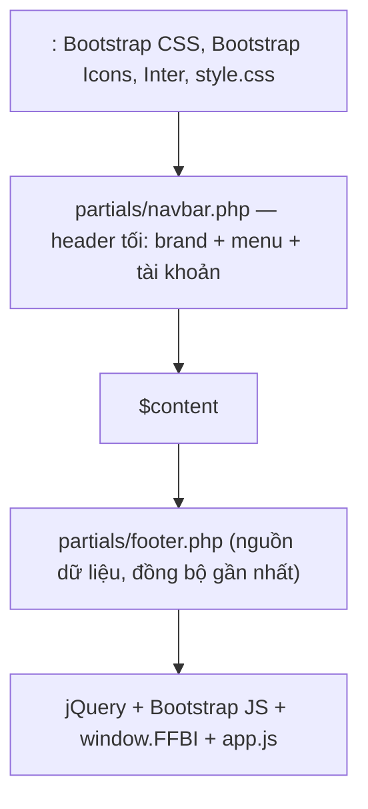

# UI.md — Thiết kế & quy ước giao diện FastFootBalInfo

Tài liệu mô tả lớp giao diện (View) của ứng dụng: bố cục, design tokens, các thành phần dùng lại,
danh mục trang, trạng thái hiển thị và tương tác động. Dùng làm chuẩn khi mở rộng hoặc chỉnh sửa UI.

## 1. Nguyên tắc thiết kế

- **Một layout chung** cho mọi trang HTML: `views/layout/main.php` (shell) + partial `navbar`/`footer`.
- **Bootstrap 5.3 làm nền**, chỉ thêm CSS tùy biến tối thiểu trong `public/style.css` (không viết lại framework).
- **Bất biến Bootstrap:** không phá vỡ class của framework; tùy biến bằng biến CSS và class riêng tiền tố `ffbi-`.
- **Ưu tiên mobile-first, không cuộn ngang** ở 375 px và hiển thị tốt ở 1366 px.
- **Không tải lại trang khi đổi tỉ số**: cập nhật DOM bằng AJAX (jQuery `$.ajax`).
- **Luôn báo rõ nguồn dữ liệu** bên thứ ba ở footer và trang tin tức.

## 2. Design tokens

Khai báo tại `public/style.css` (`:root`):

| Token | Giá trị | Ý nghĩa |
|-------|---------|---------|
| `--as-ink` | `#0f1012` | Chữ chính / header tối |
| `--as-bg` | `#f5f4f1` | Nền trang |
| `--as-line` | `#e6e3dd` | Đường kẻ |
| `--as-red` | `#e8322a` | Nhấn thương hiệu, trạng thái "đang đá", nút chính |
| `--as-green` / `--as-amber` | `#1f9d55` / `#d9a534` | Kết thúc / nghỉ giữa hiệp |
| `--as-radius` | `14px` | Bo góc panel/hàng |

Chữ giao diện dùng **Inter**. (Component cũ đọc biến `--ff-*`, đã alias sang `--as-*`.)

## 3. Bố cục (layout shell)



- Shell: `views/layout/main.php` — nạp `$content` giữa header và footer.
- Navbar: `views/partials/navbar.php` — header tối, brand + menu + tài khoản.
- Footer: `views/partials/footer.php` — công bố nguồn dữ liệu + thời điểm đồng bộ.
- Footer luôn ở đáy: `body.d-flex.flex-column.min-vh-100`, `main.flex-grow-1`.
- **Trang chủ**: `home.php` dùng `.as-layout` = sidebar trái (giải đấu, **phân trang 15 giải/trang**) + cột phải (toolbar tab trạng thái + `.as-list` các hàng trận).

Biến truyền vào view: `$title` (tiêu đề tab) và `$user` (`\App\Models\User|null`) — navbar/footer đọc `$user`.

## 4. Thành phần (components)

| Thành phần | File | Mô tả |
|------------|------|-------|
| Navbar | `views/partials/navbar.php` | Brand, menu chính (ẩn "Đội yêu thích" khi chưa đăng nhập, "Quản trị" khi không phải ADMIN), dropdown người dùng |
| Footer | `views/partials/footer.php` | Bản quyền, công bố nguồn (`API-Football`/`Live Score API`/`Dữ liệu mẫu`), thời điểm đồng bộ |
| Hàng trận (bảng tỉ số) | `views/partials/match_row.php` | Hàng compact: giờ/phút, đội nhà (tên + logo), tỉ số, đội khách, chip trạng thái; nhóm theo giải bằng `.as-league-head` |
| Thẻ trận (dùng ở trang đội) | `views/partials/match_card.php` | Giải + giờ, chip trạng thái, **crest logo đội thật**, tỉ số 2 đội, link chi tiết |
| Crest đội | `app/helpers.php` → `crest_html()` | `` logo thật nếu có; tự gỡ ảnh khi lỗi để lộ chữ cái đầu |
| Badge trạng thái | `app/helpers.php` → `badge_trang_thai()` | Map trạng thái → lớp `ff-chip` (+ `accent_trang_thai()`, `chu_cai_dau()`) |
| Tin tức | `views/news.php` | Lưới 3 cột, ảnh thumb, sapo (3 dòng), nhãn nguồn, thời gian |
| Chi tiết tin | `views/news_detail.php` | Ảnh lớn, sapo, nút "Đọc bài đầy đủ trên VnExpress" (tin cào) hoặc nội dung HTML (tin admin) |
| Đội bóng | `views/teams.php`, `views/team.php` | Lưới đội + nút yêu thích; trang chi tiết có thống kê W/D/L |
| Giải đấu | `views/leagues.php` | Lưới giải, nhãn "Đang theo dõi", lọc theo khu vực |
| Phân trang | `app/helpers.php` → `render_pager()` | Pager Bootstrap, cửa sổ trang ±3, tự ẩn khi chỉ 1 trang |
| Cảnh báo dữ liệu cũ | `views/home.php` | Alert vàng khi API lỗi (`meta.du_lieu_cu`), ẩn mặc định |
| Bảng quản trị | `views/admin/*` | Bảng thống kê, nhật ký đồng bộ, danh sách tài khoản, cấu hình giải |
| Biểu mẫu lọc | `views/schedule.php`, `leagues.php`, `teams.php` | Form GET, giữ lựa chọn sau khi lọc |

### 4.1. Bảng màu trạng thái trận

| Trạng thái (ENUM) | Nhãn tiếng Việt | Lớp chip |
|-------------------|-----------------|----------|
| `DANG_DA` | Đang đá | `ff-chip ff-chip--live` (+ `.ff-live-dot`) |
| `NGHI_GIUA_HIEP` | Nghỉ giữa hiệp | `ff-chip ff-chip--warn` |
| `SAP_DIEN_RA` | Sắp diễn ra | `ff-chip ff-chip--soon` |
| `KET_THUC` | Kết thúc | `ff-chip ff-chip--ft` |
| `HOAN` / `HUY` | Hoãn / Hủy | `ff-chip ff-chip--muted` |

Màu accent trên đỉnh thẻ trận lấy từ `accent_trang_thai()` (đỏ = đang đá, xanh = sắp diễn ra, lục = kết thúc).

### 4.2. Nút yêu thích (trạng thái)

Nút tim xuất hiện ở danh sách đội (`views/teams.php`) và trang chi tiết đội (`views/team.php`), chỉ hiện khi đã đăng nhập.

| Trạng thái | Icon / lớp | `data-bat` | Màu |
|-----------|-----------|-----------|-----|
| Chưa yêu thích | `bi bi-heart text-danger` | `1` | Viền đỏ |
| Đã yêu thích | `bi bi-heart-fill text-danger` | `0` | **Đỏ đặc (fill)** |

- Trang danh sách đội tô đầy tim ngay khi tải bằng `fav_ids` do `PageController::doi()` truyền vào (không cần F5).
- Sau khi bấm, `public/app.js` đổi icon sang `bi bi-heart-fill text-danger` khi thêm và trả về `bi bi-heart text-danger` khi bỏ — **giữ nguyên màu đỏ**.
- `.fav-btn` được đặt `position: relative; z-index: 2` để nằm trên lớp `stretched-link` của thẻ đội (bấm được, không bị chuyển trang).

## 5. Danh mục trang (route → view)

Route dùng `index.php?r=...`; vùng quản trị dùng prefix `admin*`.

| Route | View | Kích thước trang | Ghi chú |
|-------|------|------------------|---------|
| `home` (mặc định) | `views/home.php` | **20** hàng | Bố cục 2 cột: sidebar giải đấu (**phân trang 15/trang**, tham số `lg`) + tab (Tất cả/Đang đá/Kết thúc/Sắp diễn ra) + danh sách hàng nhóm theo giải; hỗ trợ `?tt=&giai=&trang=` |
| `lich` | `views/schedule.php` | **20** trận | Lọc ngày/giải/trạng thái + phân trang |
| `tran` | `views/match.php` | 1 trận | Tỉ số, trạng thái, danh sách sự kiện |
| `giai` | `views/leagues.php` | **9** giải | Lọc tên/khu vực |
| `doi` | `views/teams.php` | **12** đội | Lọc tên/giải |
| `doi-chitiet` | `views/team.php` | — | Đội + trận sắp tới/gần đây + nút yêu thích |
| `tintuc` | `views/news.php` | **9** tin | Lưới 3 cột; tự cào tin theo TTL |
| `tintuc-chitiet` | `views/news_detail.php` | 1 tin | Dẫn nguồn VnExpress |
| `dangnhap`, `dangky` | `views/auth/*.php` | — | Form POST có CSRF |
| `yeuthich` | `views/favorites.php` | **10** đội | Yêu cầu đăng nhập |
| `admin`, `admin-taikhoan`, `admin-giai` | `views/admin/*.php` | 20 tài khoản/trang | Chỉ ADMIN |
| lỗi | `views/error.php` | — | 404/500 kèm minh họa |

## 6. Trạng thái hiển thị (states)

Mọi danh sách phải xử lý đủ các trạng thái:

1. **Bình thường** — có dữ liệu.
2. **Rỗng** — thông báo `.text-muted` ("Không có trận nào", "Không tìm thấy...") hoặc `alert-info`.
3. **Dữ liệu cũ** (API lỗi) — alert vàng ở trang chủ với nội dung lỗi từ `meta.thong_bao`.
4. **Lỗi hệ thống** — `views/error.php` (500) hoặc `error` khi id sai (404).
5. **Phân trang** — pager tự ẩn khi tổng ≤ 1 trang.
6. **Bị chặn quyền** — chuyển hướng tới `dangnhap?msg=can-dang-nhap`.

Quy ước thông báo phía client: dùng `alert` Bootstrap với lớp `alert-{success|warning|danger|info}`.

## 7. Responsive

`<meta name="viewport" content="width=device-width, initial-scale=1">`. Kiểm thử ở **375 px** và **1366 px**,
không cuộn ngang.

| Điểm ngắt | Bố cục |
|-----------|--------|
| `< 576px` (mobile) | Navbar thu gọn (hamburger); trang chủ 1 cột; lưới tin/đội 1 cột; ảnh tin cao 150px |
| `≥ 768px` | Lưới tin/đội 2 cột; footer 2 cột |
| `≥ 992px` (desktop) | Trang chủ 3 cột; lưới tin/đội 3 cột |

## 8. Tương tác động (JavaScript)

`public/app.js` (jQuery), cấu hình qua `window.FFBI` (sinh trong layout):

| Hành vi | Cơ chế | Endpoint |
|---------|--------|----------|
| Cập nhật bảng tỉ số mỗi **30s** | `setInterval` + `$.ajax`, dừng khi tab ẩn, giữ `tt/q/giai/page` hiện tại, dựng lại `.as-list` | `api/matches.php?view=home` |
| Cập nhật chi tiết trận | `$.ajax` theo chu kỳ | `api/match.php?id=` |
| Bật/tắt đội yêu thích | `$.post` + token CSRF; 401 → nhắc đăng nhập | `api/favorite.php` |
| Quản trị đồng bộ / cào tin | submit form `.sync-form` qua `$.post` | `api/admin/sync.php` |

- Endpoint trả JSON chuẩn `{ ok, data, meta }` (`App\Core\JsonResponse`).
- Khi lỗi, giữ dữ liệu cũ và hiện cảnh báo — **không để trắng trang**.

## 9. Khả năng truy cập (a11y)

- Nút toggle navbar có `aria-controls`, `aria-expanded`, `aria-label`.
- Ảnh trang trí dùng `alt=""`; ảnh tin có `referrerpolicy="no-referrer"`.
- Liên kết ngoài dùng `target="_blank" rel="noopener"`.
- Không phụ thuộc màu đơn thuần: trạng thái luôn kèm **chữ** (nhãn tiếng Việt).

## 10. Cấu trúc file giao diện

```
views/
  layout/main.php          # shell
  partials/navbar.php      # điều hướng
  partials/footer.php      # chân trang + nguồn dữ liệu
  partials/match_card.php  # thẻ trận dùng lại
  home.php, schedule.php, match.php, leagues.php, teams.php, team.php
  news.php, news_detail.php, favorites.php, error.php
  auth/login.php, auth/register.php
  admin/dashboard.php, admin/users.php, admin/leagues.php
public/
  style.css   # tokens + component tùy biến
  app.js      # AJAX 30s, yêu thích, đồng bộ
app/helpers.php   # h(), route(), api(), asset(), badge_trang_thai(), accent_trang_thai(), chu_cai_dau(), crest_html(), render_pager(), dong_bo_gan_nhat()
```

## 11. Quy ước khi mở rộng

1. Trang mới: thêm route trong `PageController::dispatch` và một file view dùng layout `layout/main`.
2. Thành phần lặp lại: tách vào `views/partials/` và `require` tại chỗ dùng.
3. Màu/khoảng cách mới: thêm biến ở `:root` trong `style.css`, tránh hard-code.
4. Danh sách mới: dùng `render_pager()` và nhận `items`/`tong` từ Service để phân trang thống nhất.
5. Không viết SQL hay logic nghiệp vụ trong view — chỉ in dữ liệu và escape bằng `h()`.
6. Mọi dữ liệu ngoài (tên đội, tin tức) phải escape `h()`; chỉ nội dung HTML do ADMIN soạn mới in thô.
